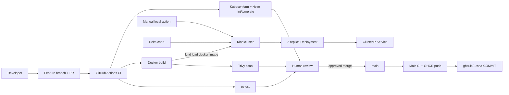

# End-to-End DevOps CI/CD with Kubernetes

A personal portfolio lab that delivers a small FastAPI service through testing, secure containerization, CI validation, GHCR publishing, and an explicit local Kind/Helm deployment. It demonstrates Strong Junior DevOps fundamentals while building on enterprise networking experience; it is **not** a production platform or a claim of professional Kubernetes experience.

## Architecture



CI never deploys to Kubernetes. Publishing occurs only after a push to `main`; local deployment remains an explicit user action.

## Technology stack

Python 3.12, FastAPI, pytest, Docker, Trivy, GitHub Actions, Kubernetes, Kind, Helm 3, Kubeconform, GHCR, Bash, and Make.

## Application endpoints

| Endpoint | Purpose |
|---|---|
| `GET /` | Service identity and message |
| `GET /health/live` | Process liveness |
| `GET /health/ready` | Traffic readiness |
| `GET /version` | Version injected from the image/deployment |

Every request produces one structured JSON log line on stdout and returns an `x-request-id` header.

## Repository structure

```text
app/                     FastAPI application
tests/                   pytest tests
.github/workflows/       PR validation and main publishing
k8s/                     Raw reference manifests (do not apply with Helm)
helm/cloud-native-api/   Deployable Helm chart
scripts/                 Portable automation and smoke tests
docs/                    Learning guide and interview Q&A
Dockerfile               Multi-stage, non-root runtime image
kind-config.yaml         Local two-node Kind cluster
Makefile                 Common developer commands
```

## Prerequisites

- Python 3.12+
- Docker Desktop or Docker Engine
- kubectl
- Kind
- Helm 3
- GNU Make, Bash, and curl
- Optional local Trivy and Kubeconform; CI always runs them

On Windows, use WSL2 (recommended) or Git Bash for Make/Bash scripts, enable Docker Desktop's WSL integration, and verify each command is visible inside the same shell.

## Local application

```bash
python -m venv .venv
source .venv/bin/activate             # Windows Git Bash: source .venv/Scripts/activate
pip install -r requirements-dev.txt
make test
uvicorn app.main:app --reload
curl http://localhost:8000/health/ready
```

## Docker workflow

```bash
make build
make run                              # http://localhost:8000
docker ps
docker logs cloud-native-api
docker inspect cloud-native-api
```

If port 8000 is busy, run `docker run --rm -p 8080:8000 cloud-native-cicd-kubernetes:local`. If health is `unhealthy`, inspect container logs, the healthcheck output in `docker inspect`, and `/health/live` from inside the container network namespace.

## Manual Kind and Helm deployment

This is intentionally manual and creates no cloud resources:

```bash
make build
make cluster-up
make deploy
make status
make smoke
kubectl -n cloud-native-demo port-forward service/cloud-native-cloud-native-api 8080:80
curl http://localhost:8080/version
```

The deploy script loads the local image into Kind, then uses Helm. Do **not** also apply `k8s/` to the same namespace: those files are reference/validation manifests and would create a duplicate deployment.

Useful operations:

```bash
kubectl -n cloud-native-demo get pods -o wide
kubectl -n cloud-native-demo describe deployment cloud-native-cloud-native-api
make logs
kubectl -n cloud-native-demo scale deployment/cloud-native-cloud-native-api --replicas=3
helm upgrade cloud-native helm/cloud-native-api -n cloud-native-demo --set image.tag=<tag>
helm history cloud-native -n cloud-native-demo
make rollback REVISION=1
make clean
```

## Raw manifests and Helm validation

```bash
kubectl apply --dry-run=client -f k8s/
helm lint helm/cloud-native-api --strict
helm template cloud-native helm/cloud-native-api --namespace cloud-native-demo
```

Use either raw manifests or Helm for a deployment, not both. Helm is the supported deployment path.

## CI/CD and GHCR

Pull requests run dependency installation, pytest, Docker build, Trivy HIGH/CRITICAL scanning, Helm lint/template, and Kubernetes schema validation. They have `contents: read` only. Pushes to `main` repeat essential tests and push exactly:

```text
ghcr.io/ahmedzaki2206/project-2-end-to-end-devops-ci-cd-with-kubernetes:sha-<40-character-commit>
```

The main workflow uses the repository-scoped, short-lived `GITHUB_TOKEN`; no registry password is stored. New GHCR packages may default to private. In the package settings, explicitly choose public visibility for a public demo. If private, create a Kubernetes registry Secret from a least-privilege GitHub PAT and reference `imagePullSecrets`—never commit the token or generated Secret. For Kind, prefer `kind load docker-image`, which needs no registry credentials.

## Security controls

- UID/GID 10001 and `runAsNonRoot`
- No privilege escalation; all Linux capabilities dropped
- Runtime default seccomp and no service-account token mount
- Read-only root filesystem with a writable in-memory `/tmp`
- CPU/memory requests and limits
- No secrets in code, images, manifests, or workflows
- Read-only PR workflow; narrowly scoped package write on `main`
- Trivy blocks fixed HIGH/CRITICAL findings
- Immutable SHA image tags and explicit deployment

## Verification, update, rollback, and cleanup

After deployment, `make smoke` checks all four endpoints through the Service. Watch a rollout with `kubectl -n cloud-native-demo rollout status deployment/cloud-native-cloud-native-api`. For a bad Helm release, inspect `helm history` and run `make rollback REVISION=<known-good>`. Remove all local cluster resources with `make clean`; optionally remove the image with `docker image rm cloud-native-cicd-kubernetes:local`.

## Troubleshooting

### CrashLoopBackOff

Run `kubectl describe pod` and `kubectl logs <pod> --previous`. Check the command, environment, read-only filesystem writes, and memory limit. The application writes only to stdout; `/tmp` is mounted writable.

### ImagePullBackOff

Confirm the exact repository/tag and `imagePullPolicy`. For local images, run `kind load docker-image cloud-native-cicd-kubernetes:local --name cloud-native-dev`. For private GHCR, validate package visibility and a non-committed `imagePullSecret`.

### Pending Pods

Use `kubectl describe pod` and inspect Events. Compare requests with node capacity, then check taints, affinity/selectors, and volumes. This lab's small requests should fit a normal Kind node.

### Failed probes

Check endpoint status from a temporary debug Pod, container logs, named port mapping, probe path, initial delay, and timeout. Readiness failure stops traffic; repeated liveness failure restarts the container.

### CI failures

Open the failed step and reproduce the exact command locally. Fix source, image, chart, or manifest rather than making security checks non-blocking.

## Cost and scope

Kind, local Docker, GitHub Actions within account quotas, and public GHCR within applicable limits can be used without paid cloud infrastructure. Review GitHub plan limits. This project excludes AWS EKS, Terraform, Prometheus, Grafana, Argo CD, GitOps, paid cloud resources, and service meshes.

## Screenshots checklist

Add only real screenshots after running the project: green PR checks, `pytest` output, healthy Docker container, two Running Pods, successful smoke test, Helm history, and a demonstrated rollback. Never fabricate screenshots or results.

Continue with the beginner-friendly [Learning Guide](docs/LEARNING_GUIDE.md) and [20 Interview Questions](docs/INTERVIEW_QA.md).

Actual local and CI evidence is tracked in [Validation Results](docs/VALIDATION_RESULTS.md). A check is never marked passed unless it was executed.

## License

MIT — see [LICENSE](LICENSE).

