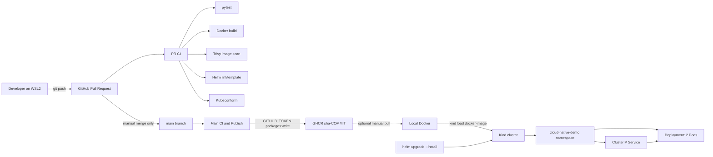
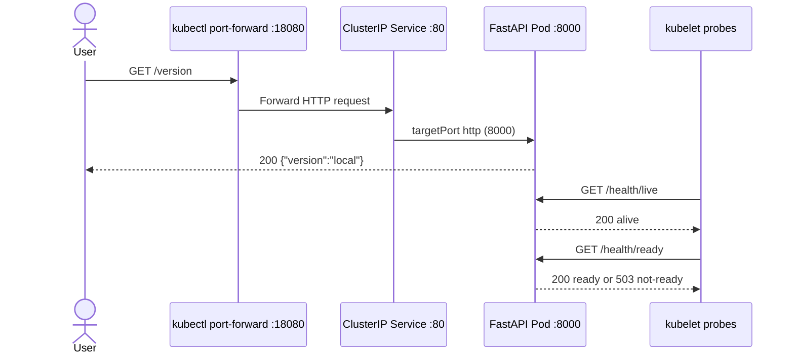

# شرح الـ Architecture الفعلية

الدليل ده مبني على الملفات الموجودة في المشروع، مش على تصميم افتراضي. المشروع بيحوّل كود FastAPI لصورة Docker، بيفحصها في GitHub Actions، وبعد الدمج على `main` بينشرها على GHCR، والـ deployment المحلي على Kind بيتم يدويًا باستخدام Helm.

## الصورة الكبيرة



مهم: مفيش خطوة في CI بتعمل deploy على Kubernetes. النشر على Kind بيحصل فقط لما المستخدم يشغّل `make deploy` أو `./scripts/deploy.sh` محليًا.

## Request flow



الـ Service نوعه `ClusterIP`، وبالتالي مش متاح من خارج الـ cluster بشكل مباشر. `scripts/smoke-test.sh` بيعمل `kubectl port-forward` مؤقت من `localhost:18080` للـ Service على port 80.

## مكونات التطبيق

`app/main.py` هو المصدر الرئيسي:

- `/` بيرجع اسم الخدمة ورسالة تشغيل.
- `/health/live` بيرجع `200` لو process شغال.
- `/health/ready` بيرجع `200` لما `APP_READY=true`، و`503` غير كده.
- `/version` بيرجع قيمة `APP_VERSION`.
- middleware بيضيف أو يحافظ على `x-request-id`، ويكتب JSON log على stdout فيه method وpath وstatus وduration.
- `LOG_LEVEL` بيتحكم في مستوى الـ logging، والقيمة الافتراضية `INFO`.

التطبيق مش متصل بقاعدة بيانات أو external service؛ لذلك readiness هنا تعليمي وبسيط، مش dependency check حقيقي.

## Docker architecture

الـ `Dockerfile` فيه مرحلتين:

1. `builder`: ينشئ virtual environment في `/opt/venv` وينزّل `requirements.txt`.
2. `runtime`: ينسخ الـ virtual environment وكود `app` فقط.

الـ container بيشتغل كـ UID/GID `10001`، مش root. الأمر النهائي هو:

```text
uvicorn app.main:app --host 0.0.0.0 --port 8000 --no-access-log
```

تم تعطيل Uvicorn access log لأن middleware التطبيق بيكتب structured JSON logs. الـ Docker healthcheck بيطلب `/health/live` كل 30 ثانية باستخدام Python standard library، وبالتالي مفيش اعتماد على `curl` داخل الصورة.

## Kubernetes objects الفعلية

| Object | الملف | الغرض |
|---|---|---|
| Kind Cluster | `kind-config.yaml` | control-plane + worker، مع host port mapping 8080 غير مستخدم حاليًا لأن Service هو ClusterIP |
| Namespace | `k8s/namespace.yaml` | عزل الموارد في `cloud-native-demo` |
| ConfigMap | `k8s/configmap.yaml` | `LOG_LEVEL=INFO` و`APP_READY=true` |
| Deployment | `k8s/deployment.yaml` | 2 replicas، RollingUpdate، probes، resources، security |
| Service | `k8s/service.yaml` | ClusterIP port 80 إلى named target port `http`/8000 |

الـ raw manifests موجودة للتعلّم والـ static validation. مسار النشر المكتوب في `scripts/deploy.sh` بيستخدم Helm chart، مش `kubectl apply -f k8s`.

## Deployment وrolling update

الـ Deployment بيطلب replica عددها 2، وبيستخدم:

```yaml
maxUnavailable: 0
maxSurge: 1
```

وقت التحديث Kubernetes يقدر ينشئ Pod إضافية، ومفروض ما يقلّش عدد الـ available Pods عن العدد المطلوب. `revisionHistoryLimit: 5` بيسمح بالاحتفاظ بخمس revisions للرجوع لنسخة سابقة. لأن النشر الفعلي Helm-managed، الرجوع الموثّق بيتم بـ `helm rollback`.

## Helm

`helm/cloud-native-api/values.yaml` بيسمح بتغيير:

- `replicaCount`
- `image.repository`, `image.tag`, `image.pullPolicy`
- namespace وService ports
- log level وreadiness flag
- CPU/memory requests and limits
- probe timing

`scripts/deploy.sh` بيعمل `helm upgrade --install` ويمرر اسم الصورة والـ tag، وبعدها ينتظر rollout. الـ namespace بيتعمل بواسطة `--create-namespace`؛ لذلك السكربت يمرر `namespace.create=false` حتى مايحصلش تعارض ownership على Namespace object.

## CI/CD flow الفعلي

### Pull Request

`.github/workflows/ci.yml` يعمل:

1. checkout.
2. Python 3.12 setup وpip cache.
3. install `requirements-dev.txt`.
4. `pytest` مع coverage threshold 90% من `pyproject.toml`.
5. Docker build باستخدام commit SHA كـ `APP_VERSION`.
6. Trivy scan للصورة، ويفشل مع fixed `HIGH` أو `CRITICAL` findings.
7. تنزيل Helm 3.16.3، ثم lint وtemplate.
8. تنزيل Kubeconform 0.6.7، ثم validation للـ raw والـ rendered manifests.

### Main branch

`.github/workflows/publish.yml` يعيد الاختبارات والفحوصات، وبعدها يسجل دخول GHCR باستخدام `GITHUB_TOKEN` محدود بـ `packages: write`، وينشر tag بالشكل:

```text
ghcr.io/ahmedzaki2206/project-2-end-to-end-devops-ci-cd-with-kubernetes:sha-<full-git-sha>
```

مفيش `latest` tag؛ الـ SHA immutable reference أوضح في التتبع والrollback. الـ publish لا يحدث على PR ولازم merge يدوي إلى `main`.

## Security controls والـ trade-offs

| Control | التنفيذ | Trade-off / limitation |
|---|---|---|
| Non-root | Docker وPod UID 10001 | التطبيق لازم مايعتمدش على privileged ports أو كتابة ملفات مملوكة لـ root |
| Read-only root filesystem | container securityContext | `/tmp` محتاج `emptyDir` writable؛ البيانات مؤقتة |
| Drop all capabilities | `capabilities.drop: [ALL]` | بعض الأدوات منخفضة المستوى مش هتشتغل، لكن التطبيق HTTP لا يحتاجها |
| No privilege escalation | `allowPrivilegeEscalation: false` | يقلل أثر compromise |
| RuntimeDefault seccomp | Pod securityContext | يمنع syscalls خطرة؛ قد يحتاج تعديل لتطبيقات مختلفة |
| No service-account token | `automountServiceAccountToken: false` | الـ Pod لا يقدر يكلم Kubernetes API، وده مناسب للتطبيق الحالي |
| ClusterIP only | Service | مفيش external ingress؛ العرض المحلي يحتاج port-forward |
| CPU/memory limits | 50m/64Mi requests، 250m/256Mi limits | limits صغيرة ومناسبة للديمو فقط، ولازم قياس قبل production |
| No secrets | لا يوجد Secret object | مناسب لأن التطبيق لا يستخدم credentials؛ ConfigMap مش مكان للأسرار |
| Pinned tool versions | Helm 3.16.3 وKubeconform 0.6.7 وTrivy 0.58.1 | pinning يحسن reproducibility لكنه يتطلب تحديث دوري |

قيود مهمة: المشروع local learning portfolio، مفيهوش TLS/Ingress/NetworkPolicy/PodDisruptionBudget/autoscaling/persistent storage أو production observability. الـ Kind cluster مش production Kubernetes، والـ host port 8080 في `kind-config.yaml` غير موصول حاليًا بأي NodePort.

